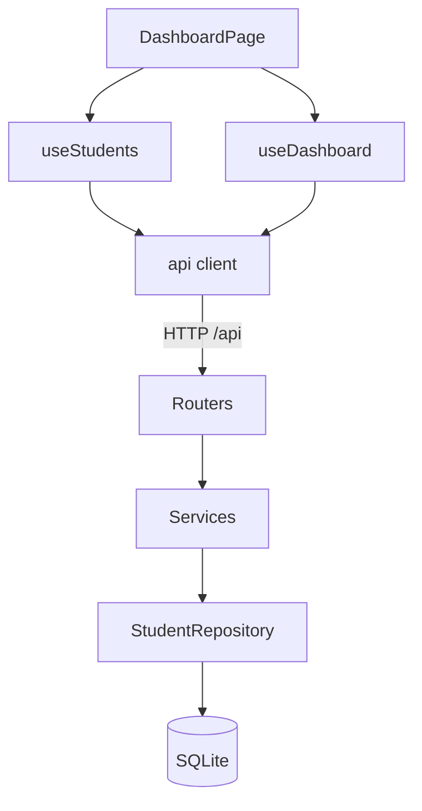

# Component Dependencies

## Backend Dependency Matrix
A "uses" B when the row depends on the column.

| | StudentService | DashboardService | StudentRepository | schemas | models | database | errors |
|---|---|---|---|---|---|---|---|
| students_router | uses | | | uses | | uses (get_db) | |
| dashboard_router | | uses | | uses | | uses (get_db) | |
| StudentService | | | uses | | | | uses |
| DashboardService | | | uses | | | | |
| StudentRepository | | | | | uses | | |
| main | | | | | | uses (init) | uses (handlers) |

Rule: dependencies point downward only (router, service, repository, model). The repository never imports from services or routers.

## Frontend Dependency Matrix
| | api/client | useStudents | useDashboard | useDebouncedValue | components |
|---|---|---|---|---|---|
| DashboardPage | | uses | uses | uses | uses |
| useStudents | uses | | | | |
| useDashboard | uses | | | | |
| components | | | | | presentational only; no API calls |

## Communication Patterns
- Frontend to backend: synchronous JSON REST. The Vite dev server proxies `/api` to `http://localhost:8000`, so there is no manual configuration.
- Backend internal: direct function calls with a per-request DB session injected by FastAPI.
- Errors: domain exceptions are converted to HTTP responses in `main`. The frontend client converts responses to `ApiError`.

## Data Flow
```
Browser (React)
  DashboardPage
    -> useDebouncedValue(search) -> useStudents(q) --+
    -> useDashboard() -----------------------------+ |
                                                    v v
                                              api/client  --HTTP /api-->  FastAPI
                                                                          routers
                                                                            |
                                                                          services
                                                                            |
                                                                        repository
                                                                            |
                                                                      SQLite (students)
```


